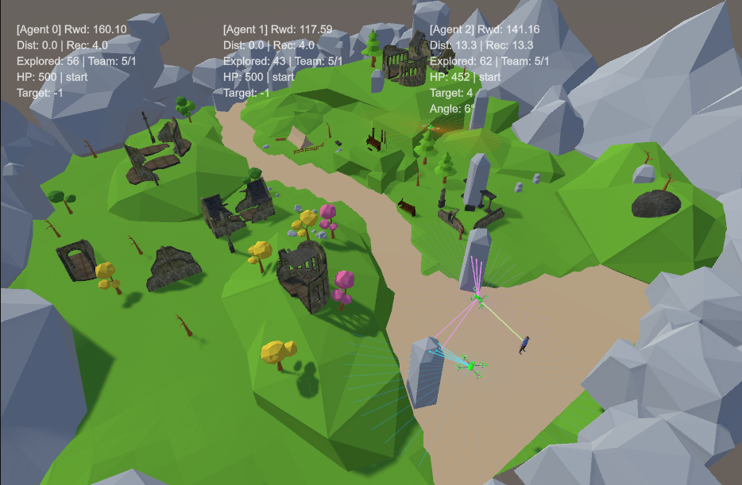
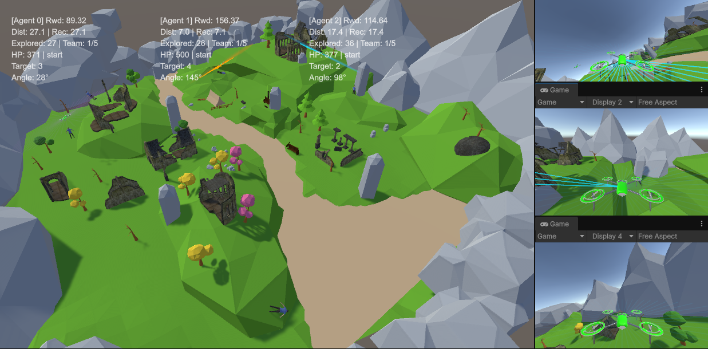
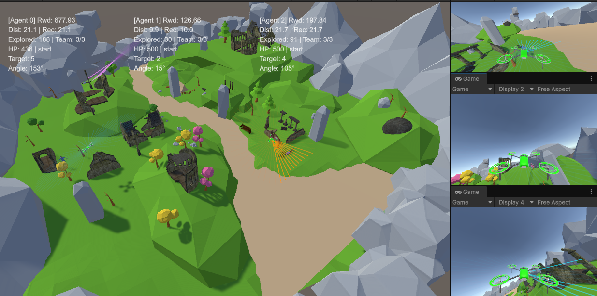
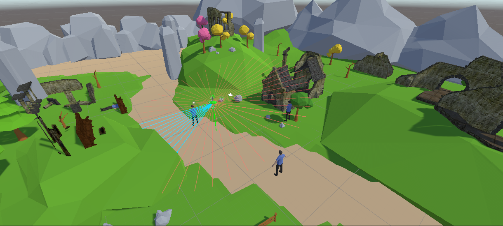
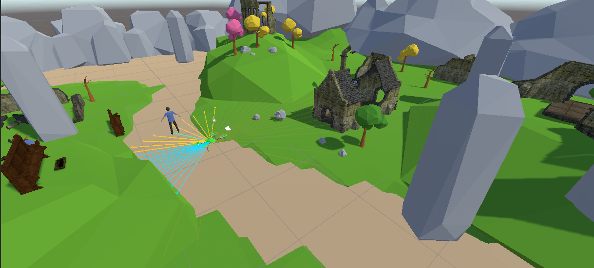
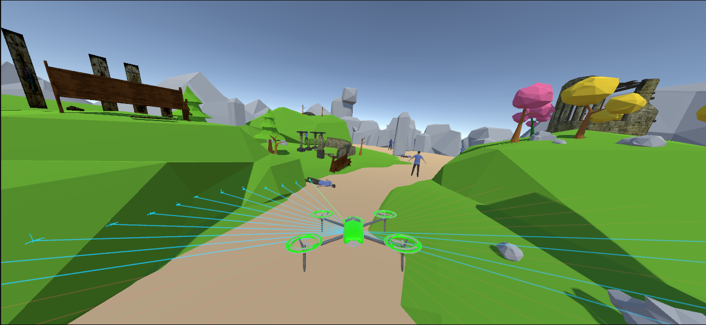

# Autonomous Drone for Search and Rescue (3D) using Deep Reinforcement Learning

_A Unity ML-Agents project focused on training autonomous quadcopters for Search and Rescue (SAR) missions in complex 3D environments with 6-DOF physics, 51-ray LiDAR proximity sensing, and cooperative multi-agent swarming._

> [!NOTE]
> This repository contains the **3D** phase of the research project. For the initial 2D baseline environment and models, visit [Unity_ML_Agent](https://github.com/saiefadnan/Unity_ML_Agent). For the overarching research narrative, experimental matrix, and comparative analysis plan, see [Thesis Roadmap](./THESIS_ROADMAP.md).

---

## Visual Demonstrations

### Cooperative Multi-Agent Swarm (S4)
| Swarm Formation & Launch | Telemetry & Victim Allocation | Parallel Area Search |
| :---: | :---: | :---: |
| [](./contents/multiAgent3D/video.mp4) | [](./contents/multiAgent3D/video.mp4) | [](./contents/multiAgent3D/video.mp4) |
| *3-drone synchronized exploration* | *Decentralized target reservation* | *Clustered victim interception* |

> 🎬 **Watch Demo Video**: [Multi-Agent 3D Swarm Flight (MP4)](./contents/multiAgent3D/video.mp4)

---

### Single-Agent Baseline (S3)
| 3D Quadcopter Dynamics | 51-Ray LiDAR Perception | Cluttered Arena Navigation |
| :---: | :---: | :---: |
| [](./contents/singleAgent3D/video.mp4) | [](./contents/singleAgent3D/video.mp4) | [](./contents/singleAgent3D/video.mp4) |
| *Angle Mode altitude & attitude hold* | *360° horizontal raycast detection* | *Static and complex obstacle avoidance* |

> 🎬 **Watch Demo Video**: [Single-Agent 3D Drone Flight (MP4)](./contents/singleAgent3D/video.mp4)

---

## Key Features

- **Realistic 3D Aerodynamics & Angle Mode Control**: Drones employ an Angle Mode physics controller utilizing 4 continuous action channels (Throttle, Roll, Pitch, Yaw) with tilt compensation in a 160(x) × 40(y) × 160(z) unit arena.
- **LiDAR Proximity Perception**: Features a 51-ray horizontal ring (360-degree LiDAR-inspired sensor coverage) detecting `Ground`, `Wall`, `Obstacle`, and `Victim` layers without the computational overhead of visual CNNs or recurrent LSTM blocks.
- **Two Distinct 3D Systems**:
  - **Single-Agent (S3)**: Baseline 3D system with 1 drone navigating cluttered spaces using a 20-dimensional observation vector and a 256×2 MLP policy.
  - **Multi-Agent (S4)**: Cooperative team of 3 drones using a 34-dimensional observation vector, 512×3 shared policy, inter-drone GPS telemetry, and centralized victim reservation to eliminate redundant search overlap.
- **Dense Reward Shaping**: Multi-component reward architecture balancing altitude maintenance, velocity stabilization, distance progress towards target victims, urgency multipliers, and collision damage penalties.
- **9-Stage Curriculum Learning**: Automated curriculum advancing through 9 difficulty stages (from hover stabilization and close-range targets to navigating long-distance obstacle courses up to 60 units).
- **Comprehensive Thesis Analysis Suite**: Complete Python toolchain for batch metric extraction, baseline evaluations (random & greedy policies), ablation studies, and publication-ready comparative plots.

---

## Technology Stack

- **Engine**: Unity 2022.3.15f1
- **RL Framework**: Unity ML-Agents Release 20
- **Programming Languages**: C# (Unity environment, flight physics, agent logic) and Python 3.8+ (ML-Agents training & analysis scripts)
- **Libraries**: PyTorch, NumPy, Pandas, Matplotlib, Seaborn

---

## Getting Started

### Prerequisites

- Unity Editor (2022.3.15f1 or later)
- Python 3.8+
- Unity ML-Agents package installed in the Unity project
- Python `ml-agents` package installed

```bash
# Clone the repository
git clone https://github.com/saiefadnan/Unity_ML_3DAgent.git
cd Unity_ML_3DAgent

# Set up Python virtual environment
python -m venv venv
# Activate on Windows:
venv\Scripts\activate
# Activate on Linux/macOS:
source venv/bin/activate

# Install dependencies
pip install mlagents torch pandas numpy matplotlib seaborn
```

### Running Inference

To inspect the trained 3D drone models in action, use `mlagents-learn` with `--inference`:

```powershell
# Run the Single-Agent (S3) trained model (drone3d_v15)
mlagents-learn config3D/single_occ_ppo.yaml --run-id=drone3d_v15 --inference

# Run the Multi-Agent (S4) trained model (multi_drone3d_v1)
mlagents-learn config3D/multi_occ_ppo.yaml --run-id=multi_drone3d_v1 --inference
```

### Training a New Model

To start training a new 3D model with curriculum learning:

```powershell
# Train a new Single-Agent (S3) model
mlagents-learn config3D/single_occ_ppo.yaml --run-id=New3DSingleRun --train

# Train a new Multi-Agent (S4) model
mlagents-learn config3D/multi_occ_ppo.yaml --run-id=New3DMultiRun --train
```

Monitor training performance live via TensorBoard:
```powershell
tensorboard --logdir results
```

---

## Repository Structure

```
/
├── 📄 README.md              # You are here (3D SAR Project Overview)
├── 📄 THESIS_ROADMAP.md      # Full 2D-to-3D thesis roadmap, ablations & experimental matrix
├── 📂 allData/               # Consolidated evaluation and training datasets (S1 to S4)
├── 📂 config3D/              # Trainer configuration (.yaml) files for PPO (S3 & S4)
├── 📂 contents/              # High-resolution screenshots and video demonstrations
│   ├── 📂 multiAgent3D/      # Swarm flight videos and demonstration images
│   └── 📂 singleAgent3D/     # Single drone flight videos and demonstration images
├── 📂 data/                  # Raw 3D test evaluation logs (.csv)
├── 📂 docs/                  # Detailed technical documentation suite
├── 📂 output/                # Comprehensive analysis reports, thesis figures, and metric summaries
├── 📂 results/               # Trained models (.onnx checkpoints) and TensorBoard logs
└── 📂 scripts/               # C# Unity controllers, configs, and Python analysis tools
    ├── 📂 analysis_scripts/      # Python evaluation, batch metrics extraction, and plotting tools
    ├── 📂 multi_agent_scripts/   # Multi-agent C# scripts (DroneController, DroneEnvironmentConfig)
    └── 📂 single_agent_scripts/  # Single-agent C# scripts
```

---

## Performance Summary

Evaluation results across 100 benchmark episodes (canonical metrics from [Table V](./output/result/TABLE_V_Test_Results.txt)):

| Metric | S1 (2D Single) | S2 (2D Multi) | S3 (3D Single) | S4 (3D Multi) |
|---|---|---|---|---|
| **Mission Success Rate (%)** | 65.0% | 100.0% | 48.3% | **56.7%** |
| **Avg Victims Rescued** | 3.90 / 6 | 6.00 / 6 | 2.90 / 6 | **3.40 / 6** |
| **Avg Steps to Complete** | 553 | 266 | 2678 | 4325 |
| **Completion Time (s)** | 27.67 s | 13.28 s | 133.89 s | 216.27 s |
| **Avg HP Survival (out of 500)** | -2.94 | 96.08 | 247.63 | **406.04** |
| **Path Efficiency** | 0.240 | 1.726 | 1.203 | **1.300** |
| **Area Coverage (cells)** | 12.5 | 23.3 | 73.6 | **124.5** |
| **Baseline Improvement (vs. Random)**¹ | +3150% | +1900% | +9560% | **+3680%** |

> ¹ **Baseline Context**: Improvement percentages measure trained PPO policy performance relative to an untrained **Random Action Policy** baseline (where random control inputs yielded 2.0% success for S1, 5.0% for S2, 0.5% for S3, and 1.5% for S4 due to severe crash frequency in complex environments). Full baseline comparison details are available in [Table VI](./output/baseline_analysis/TABLE_VI_Baseline_Comparison.txt).
>
> **Key Finding**: S4 multi-agent swarming improves drone survival by **+64.0%** over single-agent 3D (Avg HP: 406.04 vs 247.63) and boosts mission success rate to **56.7%** while distributing spatial search volume in cluttered 3D arenas.

---

## Detailed Documentation

For an in-depth review of the project's technical implementation, architecture, reward formulations, and performance benchmarks, refer to the documentation suite in `/docs`:

- [Project Overview](./docs/overview.md) — System architecture and configuration comparison
- [Environment and Task](./docs/environment_and_task.md) — 3D arena bounds, observation spaces, and ray perception
- [RL Algorithm](./docs/rl_algorithm.md) — PPO hyperparameters and curriculum progression
- [Reward Design](./docs/reward_design.md) — Mathematical reward shaping, urgency multipliers, and penalties
- [Network Architecture](./docs/network_architecture.md) — Neural network topologies (S3 256×2 vs S4 512×3)
- [Multi-Agent Setup](./docs/multi_agent.md) — Cooperative swarm design, GPS queries, and target reservation
- [Results and Analysis](./docs/results.md) — Comprehensive test metrics, rankings, and baseline comparisons
- [Thesis Roadmap](./THESIS_ROADMAP.md) — 2D-to-3D research narrative, ablations, and thesis structure
